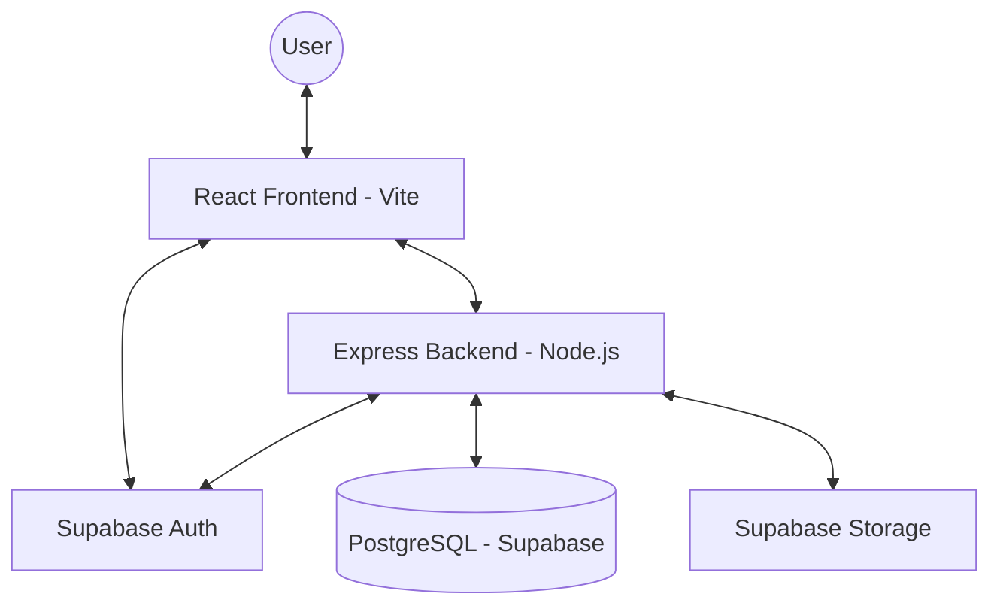
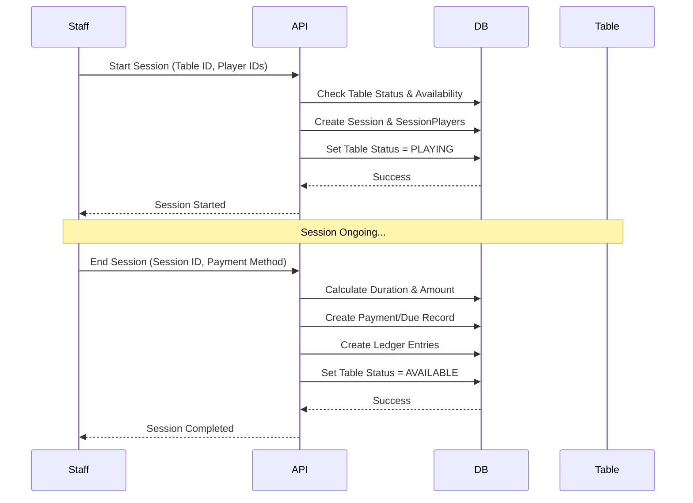

# SnookerSaaS Project Documentation

## 🚀 Project Overview
SnookerSaaS is a multi-tenant SaaS platform designed for snooker club management. It provides end-to-end operational control, from session tracking and automated billing to inventory POS, financial ledger management, and player analytics.

---

## 🏗️ Architecture & Technology Stack

### System Architecture


### Backend (server/)
- **Runtime**: Node.js with TypeScript
- **Framework**: Express.js
- **Database**: PostgreSQL (Supabase)
- **ORM**: Prisma
- **Auth**: Supabase Auth (JWT)
- **Real-time**: Supabase Realtime / Polling for live session tracking

### Frontend (webapp/)
- **Library**: React with TypeScript
- **Build Tool**: Vite
- **Styling**: Vanilla CSS with a customized premium design system
- **State Management**: React Context (Auth) + React Query (Server State)
- **Routing**: React Router DOM with Role-based Guards

---

## 🔑 Authentication & RBAC

### Auth Flow
1. **User Sign Up/In**: Handled via Supabase Client on the frontend.
2. **JWT Injection**: `apiClient.ts` intercepts requests and injects the Supabase JWT.
3. **Backend Verification**: `auth.ts` middleware verifies the token with Supabase Admin API.
4. **DB Sync (Auto-provisioning)**: If a Supabase user doesn't exist in the local Prisma DB, the middleware auto-creates the record on first request.
5. **Context Enriched**: `req.user` is populated with `userId`, `email`, `role`, `organizationId`, and `branchId`.

### Roles & Permissions
- **ADMIN (SaaS Super Admin)**: Global control over organizations, plans, ads, and system health.
- **STORE_OWNER**: Management of their specific organization (multiple branches, staff hiring, financial logs, inventory, and subscription).
- **STAFF**: Daily operations (start/end sessions, handle POS orders, settle dues).
- **PLAYER**: Personal dashboard (match history, leaderboard, wallet balance, and outstanding dues).

---

## 💾 Data Model (Prisma Highlights)

### Core Models
- **Organization**: The tenant. Stores metadata, subscription tier, and allowed payment methods.
- **Branch**: A physical location belonging to an Org.
- **User**: Individual user records (synced with Supabase).
- **Table**: Physical pool/snooker tables in a branch.
- **Session**: The heart of the app. Tracks start time, end time, hourly rates, pauses, and status (ACTIVE, PAUSED, COMPLETED).

### Financials
- **Payment**: Records of actual money received (CASH, UPI, CARD).
- **Due**: Outstanding balances if a session/order is not paid immediately.
- **LedgerEntry**: Double-entry bookkeeping logs for financial transparency.
- **InventoryItem / Order**: POS system for selling items (Coke, snacks, etc.).

---

## 🔄 Core Data Flows

### 1. Live Session Lifecycle


### 2. Payment & Dues
- **Direct Pay**: Handled during session end or via `CheckoutPaymentModal`.
- **Settle Dues**: Owner/Staff selects player → `POST /dues/settle` → Updates `Due` status to `SETTLED` → Records `Payment` → Creates `LedgerEntry`.

---

## 📈 Financial Logic
The system uses a **Double-Entry Ledger System** for transactional integrity.
- **Session Revenue**: Credited to 'Revenue' and Debited to 'Cash/UPI' (if paid) or 'Accounts Receivable' (if Dues).
- **Expense Tracking**: Deducted from branch cash-in-hand and recorded under categories like Salaries, Maintenance, or Utilities.
- **Inventory POS**: Tracks FIFO/Cost vs Price to calculate gross profit per order.

---

## 🛠️ Folder Structure

```text
webapp/
├── src/
│   ├── api/          # apiFetch wrapper
│   ├── components/   # UI elements (FeatureGate, TopNavBar, Sidebar)
│   ├── contexts/     # AuthContext
│   ├── layouts/      # Dashboard, Player, and Public layouts
│   ├── pages/        # Role-based landing pages
│   └── main.tsx      # Entry point
server/
├── prisma/           # schema.prisma
└── src/
    ├── config/       # Supabase and Prisma clients
    ├── controllers/  # Logic (Auth, Session, POS, Dues)
    ├── middleware/   # Auth and RBAC guards
    └── routes/       # Express route definitions
```

---

## 🌐 Deployment & Environment Variables

### Backend Configuration (.env)
```env
DATABASE_URL=postgres://...
SUPABASE_URL=https://...
SUPABASE_SERVICE_ROLE_KEY=...
PORT=8000
```

### Frontend Configuration (.env.production)
```env
VITE_SUPABASE_URL=https://...
VITE_SUPABASE_ANON_KEY=...
VITE_API_URL=https://your-api-url.onrender.com
```

### Deployment Steps
1. **Database**: Push schema to Supabase using `npx prisma db push`.
2. **Backend**: Deploy `server/` to Render/Heroku. Ensure env vars are set in host dashboard.
3. **Frontend**: Deploy `webapp/` to Vercel/Netlify. Set `VITE_API_URL` to point to your live backend.

---

> [!TIP]
> Always use `npm run build` to verify production-ready code before pushing. The frontend uses `import.meta.env.VITE_API_URL` to dynamically switch between local and live backends.

---

> [!NOTE]
> This project is designed for scale with multi-tenancy at its core. Every data point is scoped by `organizationId` or `branchId` to ensure total isolation between different clubs.
